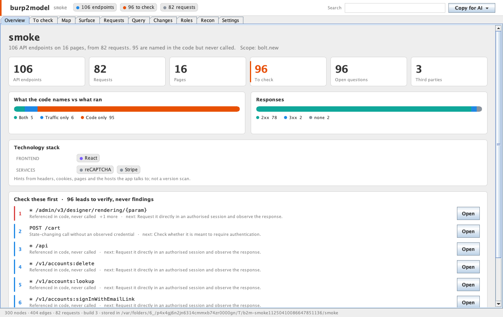
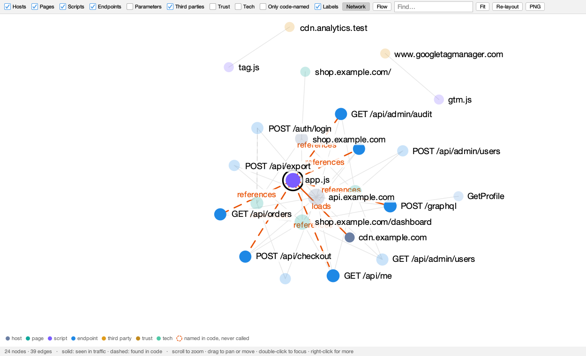
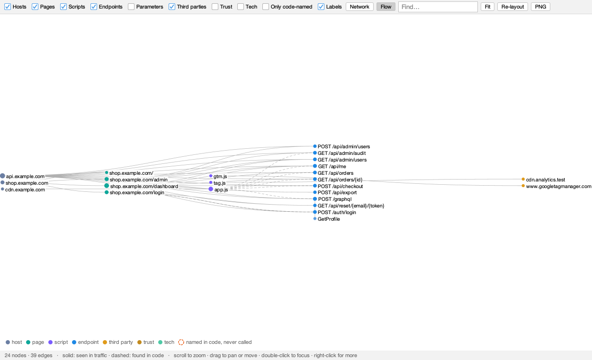

# burp2model for Burp Suite

burp2model, inside Burp. Right-click requests, choose **Send to burp2model**, and the model builds in the **burp2model** tab: every claim tied to the request that shows it, secrets masked before anything is stored. One Java jar. No Python, no local server, no files to export.



## Use it

Get `burp2model.jar` from the [extension releases](https://github.com/falc0n-researcher/burp2model/releases?q=extension), or build it (below).

1. In Burp: **Extensions > Add > Java**, pick `burp2model.jar`.
2. In Proxy history or Site map, select requests, right-click, **Send to burp2model**.
3. Open the **burp2model** tab.

Or turn on **Capture proxied traffic automatically** in Settings: in-scope Proxy traffic (Burp's target scope) joins the model every few seconds, with a build recorded every so often.

## The tabs

| Tab | What it shows |
| --- | --- |
| Overview | Counts, code vs runtime, response mix, technology stack, cookie and credential facts, the first leads |
| To check | Ranked leads with the reason and the request behind each, and the open questions ranked by value |
| Map | The model as a map you can read: a network layout or a left-to-right flow, both stable (the same model always draws the same way, and new requests keep what was placed). Zoom, drag, search, hover for details, click to see a node's neighbours, double-click to focus, right-click for more; solid lines were seen in traffic, dashed ones found in code |
| Surface | Endpoints, pages, scripts, third parties, cookies, credentials and more, as a list or a site map by path, with each thing's facts and connections |
| Requests | Every captured request, with its masked request and response, coloured and pretty-printed |
| Query | Plain questions and BQL filters and verbs, offline; every row cites evidence; copy or save results |
| Changes | Each send or snapshot is a build; see what changed between any two |
| Roles | Send each account under its own role, then compare what they reached |
| Recon | Light, passive recon on a host you are authorised to test: DNS, TLS, headers, robots.txt, security.txt, mail policy (only when you press the button) |
| Settings | Model name, role for the next send, scope, live capture, export the model or a Markdown summary |

**Copy for AI** (top right) puts a rules-first package on the clipboard for your own model: a hunting methodology, the whole model, the endpoints, or the open questions. Structure, not bytes: every id it cites resolves in its evidence table.





It follows Burp's light and dark themes. Large sessions stay fast: requests are parsed on several threads, the same script loaded twice is scanned once, and the saved requests and responses are kept compressed (20,000 requests build in about four seconds in under 400 MB).

## Query

```
list-apis · reconcile · static-only · privileged · auth-surface · secrets · unknowns
req.method:POST AND resp.code.gte:400
node.type:endpoint AND node.state:STATIC_ONLY
reach "POST /api/checkout"        blast <node> depth 2        path <a> to <b>
provenance <node>        changed-since previous        reaches-privileged user
```

`help` in the Query tab lists everything. Press ↑ for earlier queries.

## Where things are stored

Models are kept in `~/.burp2model/models/<name>/` and hold only masked requests and responses. The fingerprint key is in `~/.burp2model/key`. Nothing is sent anywhere, except by Recon (to the host you chose) and when you paste a package into your own AI.

Sending the same request twice adds it once. Every rebuild starts from the same raw paths, so sending in pieces gives the same model as sending everything at once.

## Build the jar

Java 17: `gradle jar` in this folder, or see the `extension` job in `.github/workflows/ci.yml` for the plain `javac` steps. The Java engine is checked against the Python one in `tests/test_java_parity.py` (same model, query answers and diff on the bundled samples), and `src/test/java/burp2model/Smoke.java` exercises the engine and the tab end to end.

Requires Burp 2023.x or later (Montoya API). Only capture traffic you are allowed to test.
